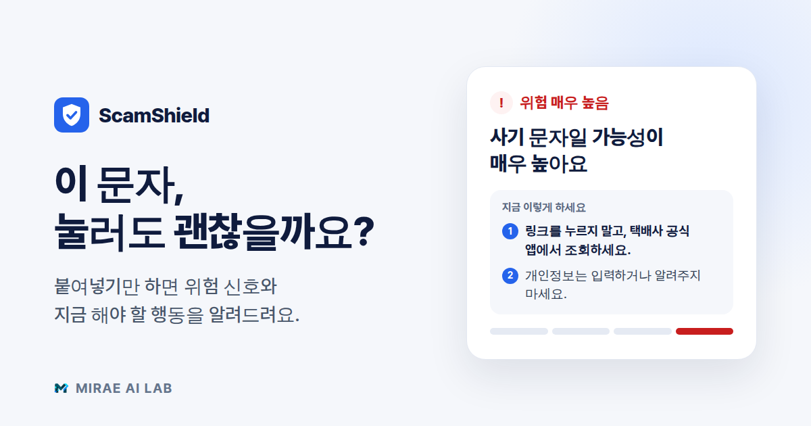

# ScamShield — 사기문자·스미싱 위험도 검사

의심스러운 문자를 붙여넣으면 **지금 어떻게 해야 하는지**를 몇 초 안에 알려주는 모바일 우선 웹앱입니다.
가입 없이 바로 쓰고, 기록은 이 기기에만 남습니다. (기획·제작: 미래AI랩)



> 분석 결과는 참고용 위험 신호 안내이며, 실제 사기 여부를 확정하는 판정이 아닙니다.
> 분석은 **규칙 기반**이며 AI(대규모 언어모델)를 쓰지 않습니다.

## 설계 원칙

1. **결론과 행동이 먼저** — 결과 화면 첫 카드는 "사기 문자일 가능성이 높아요" + "링크를 누르지 말고, 택배사 공식 앱에서 조회하세요". 점수는 아래에 보조 근거로만.
2. **쉬운 말로 된 근거** — 어떤 문구가(“CJ대한통운”, “dhl-track.top”) 왜 위험한지 한 문장씩. 고령 사용자도 읽을 수 있게.
3. **이미 행동한 사람을 먼저 돕기** — 돈을 보냈어요 / 인증번호를 알려줬어요 / 개인정보를 입력했어요 / 링크만 눌렀어요 → 순서대로 할 일과 바로 걸 전화.
4. **오탐을 줄이기** — 카드 승인·인증번호·납부·배송 같은 정상 알림을 '주의'로 겁주지 않기.
5. **신뢰감 있는 화면** — 빨간색은 위험 등급 표시에만, 어두운 보안 이미지 없이 금융·공공 서비스 톤.

## 화면 디자인

이미지가 선택을 좌우하지 않는 안전 도구이므로 **기능·행동 중심**을 기본으로 하고, 홈 첫 화면만 브랜드 비주얼을 쓰는 하이브리드 구성입니다.

| 화면 | 구성 |
| --- | --- |
| 홈 | 모바일: 파란 브랜드 영역 아래쪽에 입력 카드가 걸쳐 올라옴 (헤더·상태 표시줄도 같은 색) · 데스크톱: 브랜드 히어로 안에 입력 카드 · 상황별 사기 유형 아이콘 타일 |
| 결과(상세) | 모바일·태블릿은 하단 탭 대신 "다른 문자 / 가족에게 공유하기" 고정 버튼 (좁은 화면·큰 글자에서는 보조 버튼이 아이콘만 남음) · 할 일은 선으로 이은 단계 표시 · 근거는 아이콘 + 문제 문구 + 이유 |
| 기록 | 위험 정도를 색 배지로, 유형·받은 문자·공유 여부를 두 줄에 |
| 가이드 | 아이콘 칩 바로가기, 대표 패턴은 받은 문자 말풍선으로 |

- 색: 기존 파랑·네이비 유지. 빨강은 위험 등급 표시에만, 근거 문구 강조는 노랑(주의) 톤.
- 한글 줄바꿈: 줄이 "·카드"처럼 가운뎃점으로 시작하지 않도록 화면 표시 문구에만 보정 (`lib/typography.ts`).

## 핵심 흐름

```
홈 ─ 붙여넣기 · 캡처로 확인 · 검사   (예시 문자는 접어 둠)
 │   └ "이미 링크를 눌렀거나 돈을 보냈나요?" → /help
 ▼
/result/:id
 ├ 결론 · 지금 이렇게 하세요(1~3개) · 위험 정도 4단계(점수는 보조)
 ├ 최근 30일 같은 유형 반복 안내 → 같은 유형 기록 보기
 ├ 이미 행동했나요? 상황 4가지 → 순서대로 할 일 + 112/1332/118 바로 전화
 ├ 왜 위험한가요? 비슷한 유형 → 문제 문구 + 이유 → 받은 문자(하이라이트)
 ├ 가족에게 공유 → 보낼 내용 미리보기(링크·번호 가림) → 메신저로 보내기 / 복사
 └ (접힘) 점수는 이렇게 매겼어요 — 항목별 가산점 표, 링크·전화번호 상세
```

- 결과는 고유 주소를 가져 **새로고침·뒤로가기·딥링크**에서도 유지됩니다.
- 같은 문자를 다시 검사하면 기록을 새로 쌓지 않고 기존 기록을 교체합니다.
- 기록은 **유형 · 위험 정도 · 받은 문자 · 공유 여부**를 두 줄로 보여주고, 날짜별로 묶으며 위험 정도·유형으로 거를 수 있습니다.

## 화면

| 경로 | 역할 |
| --- | --- |
| `/` | 입력 우선 홈 — 검사 폼, 피해 대응 입구, 최근 검사, 자주 오는 사기 문자 |
| `/result/:id` | 검사 결과 (데스크톱 2열: 결론 고정 패널 + 대처·근거) |
| `/help` | 피해 대응 — 상황 선택(`/help#money` 등) · 신고·상담 전화 · 명의도용 방지 |
| `/history` | 분석 기록 — 위험 정도 필터, `?type=delivery` 유형 필터 |
| `/guide` | 상황별 대처법 — 대표 패턴 → 확인 방법 → 하지 말 것 (`/guide#payment` 등) |
| `/my` | 설정 — 글자 크기, 기록 관리 |
| `/about` | 서비스 소개 · 데모 범위 |

## 구조

```
app/                       화면 (App Router), api/analyze/route.ts — 요청 검증 후 엔진 호출
components/                ResultView, RiskMeter, RecoveryPicker, SharePreviewDialog, AnalyzeForm …
lib/
  risk-engine.ts           규칙 기반 분석 엔진 (순수 함수, 결정적)
  verdict.ts               결과 표현 규칙 — 결론·할 일·쉬운 근거·반복 유형
  recovery.ts              이미 행동한 경우의 상황별 대처 순서와 연락처
  share.ts                 가족 공유 문구 (링크·번호 가림)
  guides.ts                상황별 사기 유형 가이드
  storage.ts               기록 저장소 (localStorage + 메모리 폴백)
  validation.ts            API 요청 검증
tests/                     단위 테스트 135개
```

## 분석 엔진 (`lib/risk-engine.ts`)

문자에서 6가지 신호를 찾아 점수를 더하는 **설명 가능한 규칙 엔진**입니다. 모든 가산점은 결과 화면의
"점수는 이렇게 매겼어요" 표에 그대로 나옵니다.

| 신호 | 기본 | 예시 |
| --- | --- | --- |
| 누르게 하는 링크 | 25 | URL, 단축 URL (공식 도메인만 있으면 5) |
| 개인정보·인증 요구 | 25 | 인증번호를 알려달라, 본인 인증, 카드번호, 주소 수정, 원격 앱 설치 |
| 서두르게 만드는 말 | 20 | 즉시, 금일 내, 정지 예정, 반송·보관 중, 사건 연루 |
| 돈 요구·금전 미끼 | 20 | 송금, 30만원만 보내줘, 상품권 핀번호, 환급금, 햇살론, 수익 보장 |
| 기관·회사 이름 | 15 | 은행·카드사, 경찰·검찰, 택배사, 쇼핑·결제 회사 |
| 가족·지인·혜택 | 12 | 가족 호칭, 휴대폰 고장·임시폰, 부고·청첩장, 당첨 |

- 같은 신호의 추가 문구 +3씩(최대 +9), 단축 주소 +5, 스미싱에 흔한 주소 +12, 내용과 다른 낯선 주소 +8
- **함께 나오면 더 위험한 조합**: 가족·지인+돈 +12 · 기관+돈 +8 · 금융·기관 안내를 개인 휴대폰으로 +15 ·
  가족·혜택+낯선 링크 +18 · 가족 호칭+휴대폰 고장 +15 · "본인이 아니면 연락"+문자 속 번호 +15 ·
  수사기관+사건 연루 +15 · 기관+앱 설치 유도 +15
- 등급: 30 주의 · 60 높음 · 80 매우 높음. 100점은 "사기 확정"처럼 보여 상한 96점.

### 오탐 방지

| 장치 | 예 |
| --- | --- |
| 문맥 조건 규칙 | "인증번호는 [123456]입니다. 알려주지 마세요"는 인증번호 *요구*로 보지 않음 · "결제 완료"는 "본인이 아니면 연락" 미끼가 있을 때만 · "본인 아닐 시"도 대표번호(15xx)로 안내하면 가산 없음 · 자동이체·이체 완료는 송금 요구 아님 |
| 공식 도메인 | `go.kr`, 주요 은행·카드·택배사 도메인은 링크 가중치 5. 누구나 글을 쓸 수 있는 주소(오픈채팅 등)는 넣지 않고, `cjlogistics.com.xxx.top` 같은 흉내 주소는 공식으로 보지 않음 |
| 행동 수단 상한 | 링크·전화번호·송금 요구·메신저 유도가 하나도 없으면 29점(낮음)을 넘지 않음 — 납부 안내·반송 안내 같은 정보성 알림 보호 |
| 택배 기사 예외 | 택배 안내의 개인 휴대폰 번호는 정상(기사님 연락처)으로 보고 가산하지 않음 |

실제 문자 형식의 정상 알림 24건과 사기 14건(+샘플 15건)이 회귀 테스트로 고정되어 있습니다. V2에서 기준선 대비
'주의' 이상으로 잘못 본 정상 알림이 **10/19 → 0/19**, 기대 등급에 못 미치던 사기 문자가 **6/8 → 0/8**로 줄었습니다.

## 품질 관리

| 항목 | 방법 |
| --- | --- |
| 단위 테스트 | `npm test` — 엔진(정상 알림 오탐·사기 미탐 회귀, 문맥 규칙, 점수 근거 합계), 결과 표현, 공유 문구 가림, 반복 유형, 저장소, 요청 검증, API |
| CI | `.github/workflows/ci.yml` — typecheck → lint → test → build |
| 사용자 시나리오 | 정상 문자 / 애매한 문자 / 고위험 문자 / 이미 피해 발생 — 실제 클릭 흐름을 브라우저로 점검 |
| 접근성 | axe-core 위반 0건(전 화면·모바일·데스크톱·대응 패널·공유 창), 본문 바로가기, 포커스 표시, Esc로 닫고 포커스 복귀, 대비 4.5:1 이상, 주요 버튼·선택지 높이 44px 이상 |
| 레이아웃 | 360px + 글자 125%까지 가로 넘침 없음, 불러오는 동안 높이를 미리 확보해 CLS ≈ 0 |
| 보안 | API 본문 크기·형식 검증, 보안 헤더, 운영 의존성 `npm audit` 0건, 공유 문구에 기록 주소 미포함 |

## 데모 범위

| 기능 | 현재 |
| --- | --- |
| 위험도 분석 | 규칙 기반 엔진 (서버 API, 실패 시 브라우저에서 같은 엔진 실행) |
| 캡처 이미지 인식 | 데모 OCR — 예시 문장을 채우고 사용자가 확인·수정, 결과에 "데모 OCR" 표시 |
| AI 분석 | 연결 지점만 준비 (`app/api/analyze/route.ts`) |
| 저장 | 브라우저 localStorage (서버 저장 설계안: `supabase/schema.sql`) |

## 미래AI랩 브릿지 CTA

- 컴포넌트: `components/SampleBridgeCTA.tsx` (모든 페이지 하단)
- 링크·문구: `lib/mirae.ts`의 `MIRAE_LINKS`, `MIRAE_COPY`

## 개발

```bash
npm install
npm run dev        # http://localhost:3000
npm run check      # typecheck + lint + test
npm run build
```

환경변수는 `.env.example` 참고. 값이 없어도 완전히 동작합니다.
